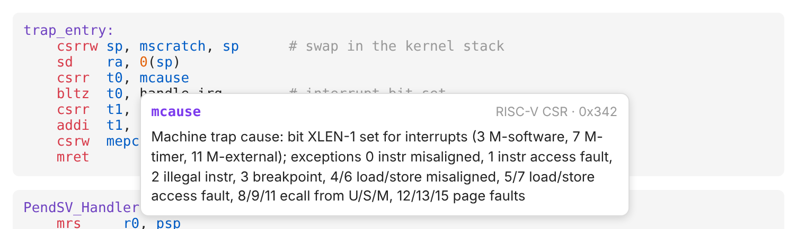
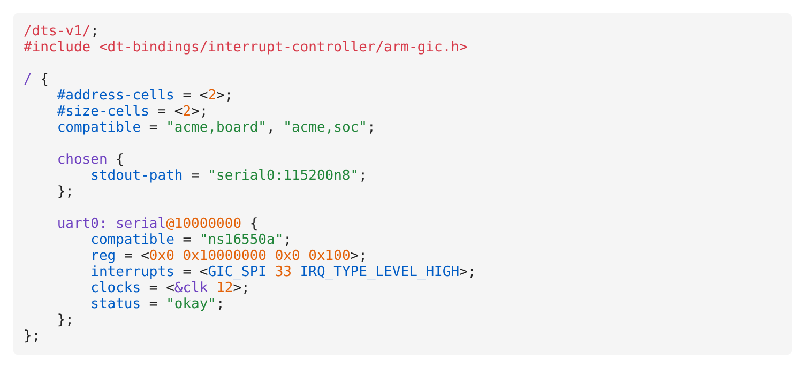
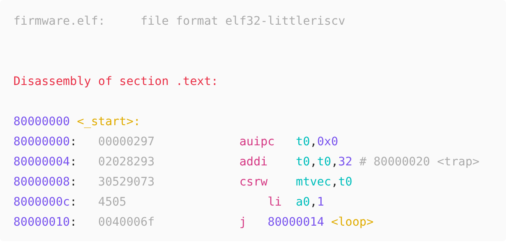
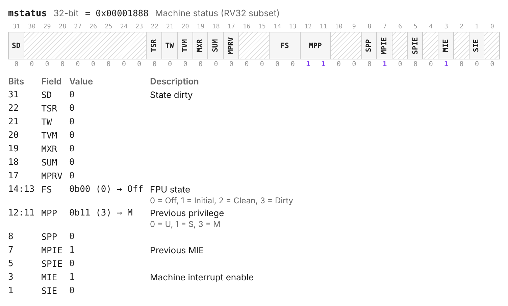
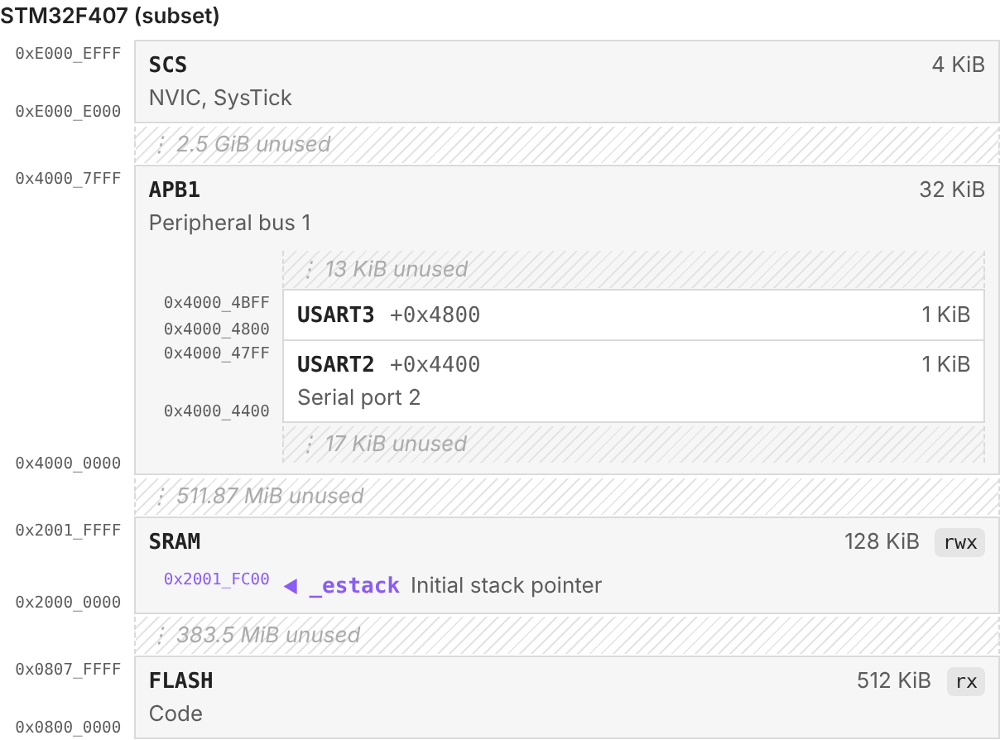
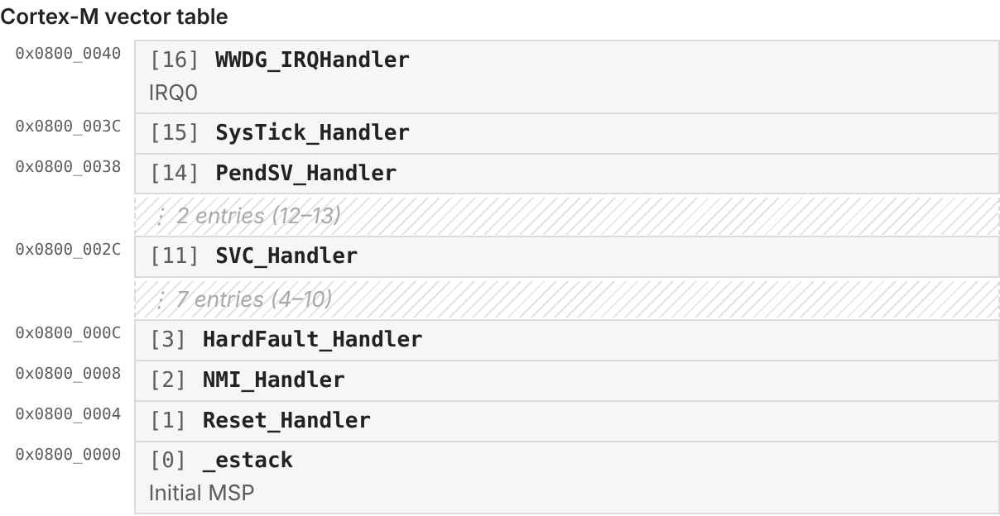

# Asmlight

An Obsidian plugin for low-level and embedded-systems notes. It adds:

- **Syntax highlighting** for RISC-V, ARM (AArch32/Thumb and AArch64) assembly, Makefiles, GNU ld linker scripts and Devicetree source.
- **Hover cards** that explain the instruction, register, CSR or keyword under your mouse.
- **Disassembly highlighting** for pasted `objdump -d` and GDB `disassemble` output, with the same colors and hover cards as assembly.
- **Register diagrams** that turn a short plain-text description into a bitfield drawing, and can decode a value for you.
- **Memory maps** that lay out regions, peripherals and vector tables by address, so you can see what sits next to what.



It works in Reading view, Live Preview and Source mode, on desktop and mobile, and uses your theme's colors.

- [Install](#install)
- [Quick start](#quick-start)
- [Languages](#languages)
- [Disassembly](#disassembly)
- [Hover cards](#hover-cards)
- [Register diagrams](#register-diagrams)
- [Memory maps](#memory-maps)
- [Customizing colors](#customizing-colors)
- [Known limitations](#known-limitations)
- [Development](#development)

## Install

Asmlight isn't in the community plugin list yet, so install it by hand:

1. Build it: `git clone https://github.com/mecilh/asmlight && cd asmlight && npm install && npm run build`
2. Create the folder `<your vault>/.obsidian/plugins/asmlight/`.
3. Copy `main.js`, `manifest.json` and `styles.css` into that folder. All three are needed: `styles.css` styles the hover cards and diagrams.
4. In Obsidian, go to **Settings → Community plugins**, reload the list and enable **Asmlight**.

> **Upgrading from an `asmligh` build?** The plugin id was misspelled before 0.3.0. Delete the old `.obsidian/plugins/asmligh/` folder. Also change `asmligh` to `asmlight` in any CSS snippets you wrote.

## Quick start

Paste this into a note:

````markdown
```riscv
trap_entry:
    csrrw sp, mscratch, sp      # swap in the kernel stack
    csrr  t0, mcause
    bltz  t0, handle_irq        # top bit set = interrupt
    mret
```

```regmap
mstatus: 32 = 0x1888
MPP  12:11  Previous privilege {0: U, 1: S, 3: M}
MPIE 7      Previous MIE
MIE  3      Machine interrupt enable
```
````

The first block is highlighted: hover `mcause` or `mret` to see what they do. The second block becomes a diagram of `mstatus`, with the value decoded: MPP = M-mode, MPIE = 1, MIE = 1.

## Languages

Use one of these tags after the opening ```` ``` ````. Tags are case-insensitive.

| Language | Fence tags | What's covered |
|---|---|---|
| RISC-V | `riscv` `risc-v` `rv` `rv32` `rv64` | I, M, A, F, D, C, Zicsr, Zifencei, Zba/Zbb, common V, pseudo-instructions, all standard CSRs |
| ARM AArch32 | `arm32` `arm` `thumb` | ARM and Thumb-2, VFP/NEON, Cortex-M special registers (`MSP`, `PSP`, `BASEPRI`, …) |
| ARM AArch64 | `arm64` `aarch64` `a64` | ARMv8-A, FP/SIMD, LSE atomics, EL1–EL3 system registers, GICv3 CPU interface |
| Makefile | `makefile` `make` `mk` `mak` | GNU Make: rules, recipes, variables, functions, conditionals, `define` blocks |
| Linker script | `linker` `ld` `lds` `linkerscript` `linker-script` | GNU ld: `MEMORY`, `SECTIONS`, region placement, symbol assignments |
| Devicetree | `dts` `dtsi` `devicetree` `device-tree` | Nodes, labels, `&references`, properties, cells, `dt-bindings` macros, `/…/` directives |
| Disassembly | `objdump` `disasm` `disassembly`, or `objdump-riscv` `objdump-arm` `objdump-arm64` | `objdump -d` and GDB `disassemble` output; see [Disassembly](#disassembly) |



All three assembly languages accept GNU-style comments and directives (`#`, `//`, `/* */`, `@`, `;`, `.word`, `%hi(sym)`, `:lo12:sym`, `1f`/`1b` local labels). In assembly, an unknown first word, such as a macro or a typo, is left uncolored on purpose.

## Disassembly

Paste `objdump -d` (or `-dS`) output, or GDB's `disassemble`, into an `objdump` block:

````markdown
```objdump
firmware.elf:     file format elf32-littleriscv

80000000 <_start>:
80000000:	00000297          	auipc	t0,0x0
80000004:	02028293          	addi	t0,t0,32 # 80000020 <trap>
```
````



- **What's highlighted:** addresses, symbols (`<_start>:`, `<loop>`, `<puts@plt>`), the `Disassembly of section` line and GDB's `=>` current-PC marker. Raw instruction bytes (`02028293`, Thumb `f44f 7380`) are dimmed.
- **Instructions** are highlighted by the RISC-V, ARM or AArch64 highlighter, so hover cards work on them too.
- **Picking the instruction set:** the `file format …` header line decides (`elf32-littleriscv`, `elf32-littlearm`, `elf64-littleaarch64`). Without a header, the first instruction that only one ISA has (`addi`, `push`, `stp`, …) decides. To force one, use `objdump-riscv`, `objdump-arm` or `objdump-arm64`.
- **Other lines,** such as interleaved C source from `objdump -S`, are left uncolored.

## Hover cards

Hover over any highlighted word to see a short explanation. Some examples:

| Hover over | You'll see |
|---|---|
| `addi`, `ldp`, `stmdb` | What the instruction does, its syntax and pseudo-code |
| `addseq`, `bls`, `itete` | ARM suffixes decoded: `add` + S (sets flags) + EQ (if Z == 1) |
| `amoadd.w.aqrl`, `fcvt.w.s`, `vadd.vx` | RISC-V suffixes decoded: operand width, memory ordering, vector operand kinds |
| `a0`, `x29`, `r7`, `v8` | Calling-convention role: argument, caller-saved, callee-saved, syscall number, … |
| `mcause`, `mtvec`, `satp` | CSR address and fields, e.g. the trap cause codes |
| `PSP`, `BASEPRI`, `CONTROL`, `IPSR` | Cortex-M behaviour (thread vs. handler stacks, priority masking, exception numbers) |
| `ESR_EL1`, `VBAR_EL1`, `TCR_EL1` | AArch64 exception classes, vector table layout, translation control |
| `$@`, `$(patsubst`, `?=`, `.PHONY` | Make automatic variables, functions, operators and special targets |
| `KEEP`, `LOADADDR`, `AT`, `.` | Linker script commands, functions and the location counter |
| `interrupts`, `reg`, `reset-gpios` | Devicetree property meaning and format |

Options are under **Settings → Asmlight**:

- **Hover cards:** turn the cards on or off.
- **Require Ctrl/Cmd:** only show a card while Ctrl (Cmd on macOS) is held, like Obsidian's page preview.
- **Hover delay:** how long to wait before a card appears.

On mobile, tap a highlighted word in Reading view to show its card.

## Register diagrams

A `regmap` (or `bitfield`) code block describes one or more registers in plain text:

````markdown
```regmap
mstatus: 32 = 0x1888  Machine status (RV32 subset)
SD    31     State dirty
TSR   22
FS    14:13  FPU state {0: Off, 1: Initial, 2: Clean, 3: Dirty}
MPP   12:11  Previous privilege {0: U, 1: S, 3: M}
MPIE  7      Previous MIE
MIE   3      Machine interrupt enable
```
````



Each line is one of:

| Line | Meaning |
|---|---|
| `name: WIDTH caption` | Starts a register, with an optional caption. Quote names that contain spaces: `"Sv39 PTE": 64`. |
| `name: WIDTH / N` | Draws N bits per row (default 32). Useful for 64-bit registers. |
| `name: WIDTH = VALUE` | Decodes VALUE: shows each bit, and each field's value in the legend. A line containing just `= VALUE` does the same. |
| `NAME HI:LO description` | A field. `HI-LO`, `[HI:LO]` or a single bit (`MIE 3`) also work. |
| `… {0: U, 1: S, 3: M}` | Named values at the end of a description. With a value set, the legend shows the match: `0b11 (3) → M`. |
| `-` `0` `1` `RES0` `RES1` `WPRI` `reserved` | Reserved field names. They are drawn hatched; `-` also has no label. |
| `# comment`, `// comment` | Ignored. |

Details:

- **Numbers:** values can be hex (`0x1888`), binary (`0b1010`), octal (`0o17`) or decimal, with `_` separators (`0x8000_0000`).
- **Gaps:** bits you don't list are drawn hatched.
- **Several registers:** one block can describe several; start each with its own `name: WIDTH` line.
- **No header:** the width becomes the smallest of 8, 16, 32, 64 or 128 that fits the highest bit.
- **Errors:** shown above the diagram. These cover overlapping fields, bits outside the register, values that don't fit, and lines that can't be read.

A good use: paste a value from GDB (`p/x $mcause`) or a datasheet next to the register description, and read off the decoded fields.

## Memory maps

A `memmap` (or `memory`, `addrmap`) block lays out an address space. Regions are sorted by address. A region inside another region is drawn inside it, with its offset. Holes between regions become a strip that says how much space is unused. This shows at a glance which peripherals are neighbours and how far apart Flash, RAM and the system area are.

````markdown
```memmap
title: STM32F407 (subset)
0x0800_0000  512K   FLASH   Code {rx}
0x2000_0000  128K   SRAM    {rwx}
0x2001_FC00         _estack Initial stack pointer
0x4000_0000  0x8000 APB1    Peripheral bus 1
0x4000_4400  1K     USART2  Serial port 2
0x4000_4800  1K     USART3
0xE000_E000..0xE000_EFFF  SCS  NVIC, SysTick
```
````



For vector tables and IRQ lines, give a `base:` (and optionally a `stride:`, default 4) and list entries by index. Skipped indices are summarised:

````markdown
```memmap
title: Cortex-M vector table
base: 0x0800_0000
[0]  _estack            Initial MSP
[1]  Reset_Handler
[11] SVC_Handler
[14] PendSV_Handler
[15] SysTick_Handler
[16] WWDG_IRQHandler    IRQ0
```
````



Each line is one of:

| Line | Meaning |
|---|---|
| `START SIZE NAME description {attrs}` | A region. SIZE can be `0x400`, `1024`, `1K`, `512K`, `1M`, `2G` (also `KiB`, `MB`). |
| `START..END NAME …` | A region given by its last address. |
| `ADDRESS NAME description` | A marker for a single address (a symbol, a stack pointer, a fault address), drawn as ◀ inside its region. |
| `[N] NAME description` | Table entry `N` at `base + N × stride`. |
| `title:` | A heading above the map. |
| `base:` / `stride:` | Where indexed entries start and how big each one is. |
| `order: up` / `order: down` | High addresses at the top (default, like datasheets and stack diagrams) or at the bottom. |
| `scale: even` / `scale: log` | All boxes the same height (default), or taller boxes for bigger regions. |
| `# comment`, `// comment` | Ignored, also at the end of a line. |

Addresses use 8 hex digits, or 16 when anything is above 4 GiB. Hovering a box shows its exact range and size. If something is wrong, an error is shown above the map: partially overlapping regions, an end below its start, a number that can't be read, or an indexed entry without `base:`.

## Customizing colors

Token colors come from your theme's code colors. To change one, add a CSS snippet (**Settings → Appearance → CSS snippets**). Every highlighted token has an `asmlight-<kind>` class. The editor adds a `cm-` prefix, so target both forms:

```css
.asmlight-register, .cm-asmlight-register { color: var(--color-orange); }
```

- **Kinds:** `comment`, `label`, `mnemonic`, `directive`, `register`, `number`, `string`, `reloc`, `keyword`, `function`, `variable`, `operator`, `property`.
- **Per-language rules:** tokens also have an `asmlight-lang-<id>` class (`riscv`, `arm32`, `arm64`, `makefile`, `linker`, `dts`, `objdump`). Instructions inside a disassembly block carry their instruction set's id.
- **Hover cards:** use `.asmlight-hover`.
- **Diagrams:** register diagrams use `.asmlight-regmap`; set `--asmlight-bit-width` on it to make bit columns wider or narrower. Memory maps use `.asmlight-memmap`.

## Known limitations

- **Tested on Obsidian 1.14.4.** Highlighting, hover cards and diagrams have been checked in Live Preview and Reading view there. Older versions should work, but haven't been tried.
- **Symbols named like registers get register colors.** For example, a label called `time` or `control` looks like a register, because those are also CSR or Cortex-M register names.
- **Indented Makefile lines.** Make requires a tab before recipe lines, but notes often use spaces. So any indented line after a rule is treated as a recipe.
- **Disassembly of other architectures** (x86, …) gets addresses, bytes and symbols highlighted, but not the instructions.
- **Coverage is focused on what courses and bare-metal code use.** Newer or rare extensions, such as the RISC-V Zv* crypto extensions or Arm SVE, aren't covered.

## Development

```sh
npm install
npm run dev     # rebuild main.js on change
npm test        # vitest
npm run build   # typecheck + production build
```

Where things live:

- `src/lang/`: the Makefile, linker script, Devicetree and disassembly tokenizers.
- `src/isa/`: assembly instruction and register tables.
- `src/docs/`: hover-card text.
- `src/regmap/` and `src/memmap/`: the register-diagram and memory-map parsers and renderers.

To document a new instruction, add a row to the matching `src/docs/<isa>.ts` table. The test suite fails if any highlighted instruction or register has no hover card.

## License

MIT
